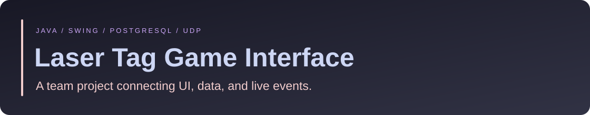

<p align="center"></p>

[Regan Yates](https://github.com/rjyates) · [Homelab](https://github.com/rjyates/homelab)


# Team 10 — laser-tag game interface

A collaborative software-engineering project combining a Swing player-entry interface, PostgreSQL player lookup/storage, a countdown/action display, and UDP game events.

**Status:** legacy team project. The Java source compiled with JDK 19 and the bundled PostgreSQL driver on October 22, 2026. A database-backed game session was not re-tested.

## Team attribution

| Contributor | GitHub |
| :--- | :--- |
| Aleena Ahmad | [aleenaahmad1](https://github.com/aleenaahmad1) |
| Fernanda Caero | [mfcaeroc](https://github.com/mfcaeroc) |
| Charlie Whitehead | [charliewhitehead](https://github.com/charliewhitehead) |
| Maddie Wilkinson | [maddie-wilkinson](https://github.com/maddie-wilkinson) |
| Regan Yates | [rjyates](https://github.com/rjyates) |

The repository represents shared team work. Specific individual feature ownership is not assigned without supporting evidence.

## Build

From the repository root, with a JDK installed:

```text
javac -cp postgresql-42.6.0.jar *.java
```

Run on macOS/Linux:

```bash
java -cp "postgresql-42.6.0.jar:." laser
```

Run on Windows:

```powershell
java -cp "postgresql-42.6.0.jar;." laser
```

## Runtime prerequisites

The application expects its original classroom PostgreSQL setup and player table. The code references `player.id` and `player.codename`; a complete provisioning/migration script is not supplied here. Legacy database connection settings are embedded in `laser.java` and need review/replacement before adapting the project. Do not reuse them for a real environment.

Keep image/countdown assets in place. [python_trafficgenarator_v2.py](python_trafficgenarator_v2.py) is a Python traffic simulator for the original local game workflow; it expects interactive equipment IDs and matching UDP ports. It was not run during this review.

## Source map

| File | Responsibility |
| :--- | :--- |
| [laser.java](laser.java) | Entry point, player entry, and database handler |
| [UDP.java](UDP.java) | Game-event messaging |
| [countdown.java](countdown.java) | Countdown interface |
| [actiondisplay.java](actiondisplay.java) | Action/game display |
| [python_trafficgenarator_v2.py](python_trafficgenarator_v2.py) | Historical local test traffic |

## What this demonstrates

Integration across UI, persistent data, and event-driven communication in a shared project. It also illustrates why explicit environment setup, credential configuration, and end-to-end tests matter when revisiting older software.

The compiler reports unchecked operations in `UDP.java`. Runtime behavior, database compatibility, asset/audio licensing, and a fresh complete game session remain unverified. No production deployment or sole authorship is claimed.
